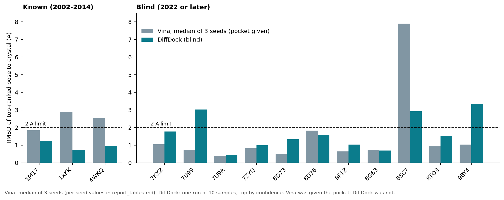

# EGFR Virtual Screening | Portfolio Starter

**Project:** Retrospective virtual screening of EGFR inhibitors using public biochemical activity measurements and structure-based docking.

**Author:** Pedro Paulo de Melo Ferreira  
**Research question:** Can a transparent cheminformatics filtering and docking workflow prioritize experimentally characterized EGFR inhibitors, and what are its limitations?

**What this is NOT:** Discovery or validation of a new drug; docking scores do not measure clinical effectiveness, selectivity, safety, or experimental binding affinity.

## Status and main results

The validation stage is complete; the ranking (screening-power) stage is **not**. Full details, methods and limitations are in [REPORT.md](REPORT.md).

| Test | Result |
|---|---|
| Redocking on 11 EGFR-inhibitor complexes released in 2022 or later | AutoDock Vina (pocket given): **10 of 11** correct; DiffDock (blind): **8 of 11** correct |
| Redocking on the classic complexes 1M17, 4WKQ, 1XKK | Vina: 1 of 3 (2.5 to 2.9 Å for the other two); DiffDock: 3 of 3 (probably in its training data) |
| First ranking of 16 ChEMBL compounds | **Not interpreted**: made before validation, no inactives or decoys |

A pose is correct when the heavy-atom RMSD to the crystal ligand is at most 2.0 Å. Vina results varied with the random seed (two complexes had one failing seed of three), so single runs should not be trusted.

**Not done yet:** enrichment analysis (actives vs inactives vs decoys), cross-docking, structures released after 2023 (they lack a PDB-format file).



## Scientific choices

- **Target:** human epidermal growth factor receptor (EGFR), kinase domain, **wild-type structure**.
- **Protein structure:** [RCSB PDB 1M17](https://www.rcsb.org/structure/1M17), crystallized with **erlotinib (ligand code AQ4)**, resolution **2.60 Å**.
- **Biochemical reference data:** [ChEMBL](https://www.ebi.ac.uk/chembl/) activities for target **CHEMBL203** (EGFR/ERBB1). We restrict to numeric, exact `IC50` in `nM` and human target, then summarize multiple experimental measurements by median for **exploratory purposes only**.
- **Descriptor calculations:** [RDKit](https://www.rdkit.org/).
- **Optional docking:** [AutoDock Vina](https://vina.scripps.edu/) + [Meeko](https://meeko.readthedocs.io/).

## Recommended first session (60–120 minutes, depending on setup)

1. Install Python 3.10–3.12 (ideally via Miniforge) and create a new environment.
2. Download this folder and open a terminal inside it.
3. Install dependencies. For the full pipeline (including Vina and Meeko) use the conda environment:

   ```bash
   conda env create -f environment.yml
   conda activate egfr-vs
   ```

   For descriptors and conformers only, `python -m pip install -r requirements-base.txt` is enough. DiffDock needs its own environment (Python 3.9, PyTorch 1.13.1+cu117, a CUDA GPU); see [REPORT.md](REPORT.md#8-reproducibility).

4. Download 1M17 and compute a provisional docking search box centered on the co-crystal ligand:

   ```bash
   python scripts/01_target.py
   ```

5. Retrieve ChEMBL activity records and compute descriptors:

   ```bash
   python scripts/02_chembl.py --max-records 500
   ```

6. Generate 3D conformers (experimental structures are **not** inferred from these conformers):

   ```bash
   python scripts/03_ligands.py
   ```

Afterwards inspect `data/`, `figures/` and `results/`. It is normal for the ChEMBL query to take a little longer, and an Internet connection is required for scripts 01 and 02.

## Optional docking stage (requires additional environment preparation)

AutoDock Vina's command-line executable and Python bindings are not the same installation. Make sure `vina --help` works, and follow the official [installation docs](https://autodock-vina.readthedocs.io/en/latest/installation.html). Make sure `mk_prepare_ligand.py --help` and `mk_prepare_receptor.py --help` work; install Meeko and dependencies per the [official instructions](https://autodock-vina.readthedocs.io/en/latest/docking_requirements.html).

**Protein preparation is a scientific decision, not a file-conversion formality:** inspect 1M17 for missing residues/atoms, alt-locations, waters, protonation and relevant cofactors, and resolve any Meeko errors before docking. The starter script strips the crystallized ligand and other HETATM records to create a *provisional* protein PDB, **not** a validated docking receptor.

For an initial experiment, after reviewing the structure and completing necessary receptor preparation, this command may work:

```bash
mk_prepare_receptor.py --read_pdb data/egfr_protein_provisional.pdb --write_pdbqt data/egfr_receptor.pdbqt
```

Review any warnings/errors, generated atom types, charge/protonation, and target pocket coordinates. Only if receptor preparation succeeds:

```bash
python scripts/04_docking.py
```

`04_docking.py` prepares each ligand using Meeko, calls the `vina` command-line executable with a fixed seed, writes docking structures and saves a score table. Its comparison must be treated as **exploratory**. Scores (kcal/mol) are not measured ΔG values and cannot be directly converted to IC50.

**Before interpreting rankings, a redocking validation is required:** remove the bound ligand, rebuild it with valid chemistry, dock it back, and compare the predicted pose to the crystallographic pose by heavy-atom RMSD with chemically correct atom mapping (working criterion: 2 Å). This was done for erlotinib, gefitinib, lapatinib and 11 newer complexes; see [REPORT.md](REPORT.md). The scripts are `04b_redocking.py` (erlotinib), `04c_redocking_sweep.py` (box size, exhaustiveness, waters), `04d_redock_multi.py` (several complexes), `06_diffdock.py` (DiffDock) and `07_blind_select.py` plus `08_blind_run.py` (blind set). Docking known actives to their own target is a retrospective demonstration, not an independent prediction of novel actives.

## Documentation

Project documentation (overview, methodology, results, limitations) is in [`docs/`](docs/README.md).

## Dashboard

A React + FastAPI dashboard to browse complexes, poses and results lives in [`dashboard/`](dashboard/README.md).

## Folder structure

```text
scripts/01_target.py       Download structure and compute ligand-derived box
scripts/02_chembl.py       Curate activities and plot chemical descriptors
scripts/03_ligands.py      Generate ligand SDF 3D conformers
scripts/04_docking.py      OPTIONAL Meeko + Vina screen
scripts/05_analysis.py     OPTIONAL exploratory score comparison
scripts/04b_redocking.py   Erlotinib redocking into 1M17 (Vina) with RMSD to the crystal pose
scripts/04c_redocking_sweep.py  Box size, exhaustiveness and water sweep
scripts/04d_redock_multi.py     Vina redocking on 1M17, 4WKQ, 1XKK
scripts/06_diffdock.py     DiffDock on the same complexes (own conda env and GPU)
scripts/07_blind_select.py Select EGFR-inhibitor complexes released in 2022 or later (fixed rules)
scripts/08_blind_run.py    Vina and DiffDock on the blind set
scripts/09_report_figures.py  Tables and figure used in REPORT.md
data/                   Downloaded PDB, ChEMBL CSV and SDFs (generated)
figures/                Plots (generated)
results/                Rankings and observations (generated)
tests/                  Offline tests of core calculations
dashboard/              FastAPI backend + React frontend
```

## Questions to discuss in your write-up

1. What does the EGFR target do, and why is erlotinib a useful known ligand?
2. How many activities were downloaded, discarded, and retained, and why?
3. Are different IC50 assays comparable? (Not necessarily. Show assay/document provenance.)
4. How do molecular-weight and logP filters alter the compounds selected?
5. Does the docking protocol reproduce the experimentally observed binding mode of erlotinib?
6. Which predictions are uncertain (protonation, water molecules, protein flexibility, scoring function)?
7. Why would biochemical confirmation and selectivity/cellular assays be needed?

## Sharing the project on LinkedIn

A post that matches the current, verified state: *"As the first stage of a reproducible EGFR virtual-screening project, I tested whether docking recovers experimental binding modes. On 11 EGFR-inhibitor crystal structures released in 2022 or later, AutoDock Vina (given the pocket) reproduced the crystal pose in 10 and DiffDock (no pocket given) in 8, using a 2 Å RMSD criterion. Vina results varied with the random seed, so I report several seeds. Next: testing whether the protocol ranks known actives above inactives and decoys. Limitations are documented in the report."* Keep the claims to what REPORT.md supports; the ranking test is not done yet.

Only claim numerical results after you have generated and checked them. Prefer an English README, method details, code screenshots, and the generated figure to generic claims about identifying new drugs.

## References

- [RCSB 1M17](https://www.rcsb.org/structure/1M17)
- [ChEMBL API](https://chembl.gitbook.io/chembl-interface-documentation/web-services/chembl-data-web-services)
- [RDKit documentation](https://www.rdkit.org/docs/)
- [AutoDock Vina documentation](https://autodock-vina.readthedocs.io/en/latest/)
- [Meeko](https://meeko.readthedocs.io/)

## License

Code is released under the [MIT License](LICENSE). Review and cite original data and software licensing/attribution terms before redistributing large data extracts or structure files.
